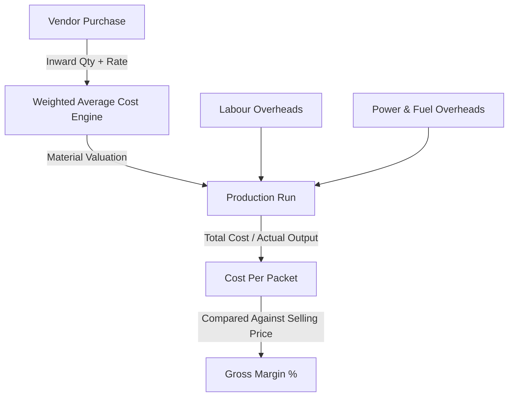
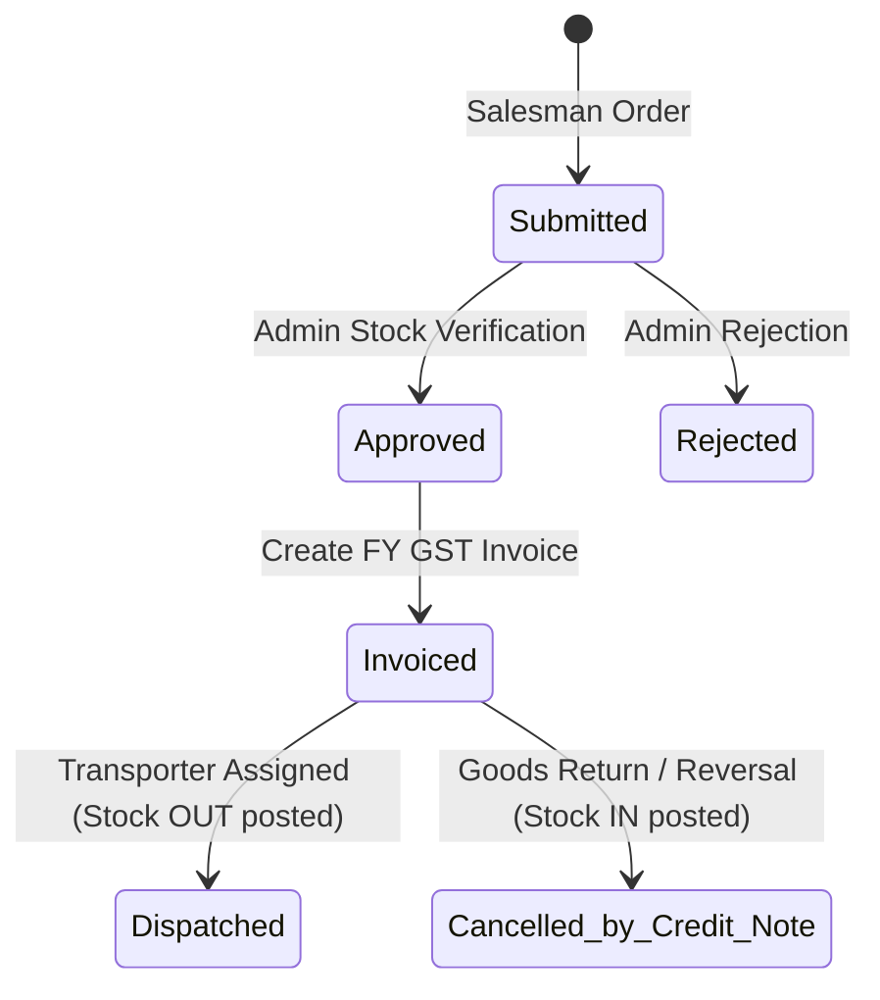

# Design Note: Order-to-Audit ERP Architecture

**Organization**: Sri Lakshmi Snacks, Tiruchirappalli, Tamil Nadu  
**Core Thesis**: A single append-only stock ledger as the immutable source of truth, zero floating-point arithmetic, strict GST compliance, weighted-average costing, and automated audit logging.

---

## 1. Domain Entity Relationship Diagram

The following Mermaid ER Diagram models the complete schema across Authentication, Master Data, Stock Ledger, Production, Sales, Billing, and Audit domains:

```mermaid
erDiagram
    USERS ||--o{ ORDERS : "creates"
    USERS ||--o{ PRODUCTION_RUNS : "supervises"
    USERS ||--o{ INVOICES : "issues"
    USERS ||--o{ AUDIT_LOG : "triggers"
    USERS ||--o{ STOCK_LEDGER : "records"

    CUSTOMERS ||--o{ ORDERS : "places"
    CUSTOMERS ||--o{ INVOICES : "billed_to"
    CUSTOMERS ||--o{ PAYMENTS : "remits"
    CUSTOMERS ||--o{ CREDIT_NOTES : "credited"

    SUPPLIERS ||--o{ PURCHASES : "supplies"

    PRODUCTS ||--o{ BOM : "defines_recipe"
    PRODUCTS ||--o{ ORDER_ITEMS : "ordered_in"
    PRODUCTS ||--o{ INVOICE_ITEMS : "billed_in"
    PRODUCTS ||--o{ PRODUCTION_RUNS : "manufactured_in"

    RAW_MATERIALS ||--o{ BOM_ITEMS : "component_of"
    RAW_MATERIALS ||--o{ PURCHASE_ITEMS : "purchased_in"
    RAW_MATERIALS ||--o{ PRODUCTION_ISSUED_ITEMS : "consumed_in"

    BOM ||--|{ BOM_ITEMS : "contains"

    PURCHASES ||--|{ PURCHASE_ITEMS : "contains"
    PURCHASES ||--o{ STOCK_LEDGER : "posts_inward"

    ORDERS ||--|{ ORDER_ITEMS : "contains"
    ORDERS ||--o{ INVOICES : "converted_to"

    INVOICES ||--|{ INVOICE_ITEMS : "contains"
    INVOICES ||--o{ DISPATCHES : "fulfilled_by"
    INVOICES ||--o{ CREDIT_NOTES : "adjusted_by"

    DISPATCHES ||--o{ STOCK_LEDGER : "posts_outward"

    PRODUCTION_RUNS ||--|{ PRODUCTION_ISSUED_ITEMS : "issues"
    PRODUCTION_RUNS ||--o{ PRODUCTION_OVERHEADS : "incurs"
    PRODUCTION_RUNS ||--o{ STOCK_LEDGER : "posts_movements"

    USERS {
        int id PK
        string username UK
        string email UK
        string hashed_password
        string full_name
        string role "salesman|admin|production|accountant|owner"
        boolean is_active
        datetime created_at
    }

    CUSTOMERS {
        int id PK
        string name
        string gstin
        string state_code "33 for Tamil Nadu"
        string customer_type "retailer|distributor|wholesaler"
        string city
        string address
        string phone
    }

    SUPPLIERS {
        int id PK
        string name
        string gstin
        string state_code
        string contact_person
        string phone
    }

    PRODUCTS {
        int id PK
        string code UK
        string name
        string hsn_code "19059040"
        decimal gst_rate "0.0500"
        decimal pack_size_grams "200.0"
        bigint default_price_paise "5000"
    }

    RAW_MATERIALS {
        int id PK
        string code UK
        string name
        string material_type "raw|packaging"
        string base_unit "g|ml|piece"
        decimal reorder_level_base
    }

    BOM {
        int id PK
        int product_id FK
        string name
        int expected_yield_packets "200"
        decimal batch_size_multiplier
    }

    BOM_ITEMS {
        int id PK
        int bom_id FK
        int raw_material_id FK
        decimal standard_qty_base
    }

    STOCK_LEDGER {
        int id PK
        string item_type "raw_material|packaging|finished_goods"
        int item_id
        string location_type "raw|packaging|finished"
        decimal qty_base "precision 14,4"
        string direction "IN|OUT"
        string source_doc_type "PURCHASE|PRODUCTION_RUN|DISPATCH|CREDIT_NOTE"
        int source_doc_id
        string batch_no
        numeric unit_cost_paise "precision 14,4"
        int created_by_user_id FK
        datetime created_at
    }

    PURCHASES {
        int id PK
        string po_number UK
        int supplier_id FK
        string invoice_number
        date purchase_date
        bigint total_amount_paise
    }

    PURCHASE_ITEMS {
        int id PK
        int purchase_id FK
        int raw_material_id FK
        decimal qty_base
        bigint unit_rate_paise
        bigint line_total_paise
    }

    PRODUCTION_RUNS {
        int id PK
        string run_number UK
        int product_id FK
        int bom_id FK
        int planned_batches
        int actual_good_output_packets
        int actual_damaged_pouches
        int actual_cartons_used
        decimal yield_variance_pct
        boolean is_variance_flagged
        string status "completed"
    }

    PRODUCTION_ISSUED_ITEMS {
        int id PK
        int production_run_id FK
        int raw_material_id FK
        decimal standard_qty_base
        decimal actual_qty_base
        decimal variance_pct
        bigint variance_paise
        boolean is_variance_flagged
    }

    PRODUCTION_OVERHEADS {
        int id PK
        int production_run_id FK
        string overhead_type "labour|gas_power|depreciation"
        bigint amount_paise
    }

    ORDERS {
        int id PK
        string order_number UK
        int customer_id FK
        string status "submitted|approved|rejected|invoiced|dispatched"
        bigint subtotal_paise
        bigint cgst_paise
        bigint sgst_paise
        bigint igst_paise
        bigint total_amount_paise
    }

    ORDER_ITEMS {
        int id PK
        int order_id FK
        int product_id FK
        int quantity_packets
        bigint unit_price_paise
        bigint line_total_paise
    }

    INVOICES {
        int id PK
        string invoice_number UK "TN/2026-27/0001"
        int order_id FK
        int customer_id FK
        date invoice_date
        string status "posted|cancelled"
        bigint total_amount_paise
    }

    INVOICE_ITEMS {
        int id PK
        int invoice_id FK
        int product_id FK
        int quantity_packets
        bigint taxable_amount_paise
        bigint cgst_paise
        bigint sgst_paise
        bigint igst_paise
        bigint total_amount_paise
    }

    DISPATCHES {
        int id PK
        string dispatch_number UK
        int invoice_id FK
        string vehicle_number
        string driver_name
        datetime dispatch_time
    }

    PAYMENTS {
        int id PK
        int customer_id FK
        int invoice_id FK
        date payment_date
        bigint amount_paise
        string payment_mode "neft|upi|cash|cheque"
    }

    CREDIT_NOTES {
        int id PK
        string credit_note_number UK
        int invoice_id FK
        int customer_id FK
        bigint amount_paise
        string reason
    }

    AUDIT_LOG {
        int id PK
        int user_id FK
        string entity_name
        int entity_id
        string action "CREATE|UPDATE|CANCEL"
        json old_values
        json new_values
        datetime created_at
    }
```



---

## 2. Append-Only Stock Ledger Source-of-Truth Mechanics

### The Core Architectural Problem
Traditional ERP systems maintain a mutable `current_stock` column on item tables (`UPDATE products SET stock = stock - 10`). This creates severe operational failure modes:
1. **Lost Updates & Race Conditions**: Concurrent dispatches or receipts overwrite each other's balances under high load.
2. **Missing Forensic History**: If stock goes out of balance, it is impossible to determine which order or operator caused the discrepancy.
3. **Audit Impossibility**: Point-in-time inventory audits (e.g., *"What was our flour balance at 10:00 AM on March 31?"*) cannot be reconstructed.

### The Solution: Ledger Append-Only
In this system, `stock_ledger` is strictly append-only. There are **zero** update and delete queries permitted against this table.

Every physical movement writes an immutable row:
- `direction = 'IN'`: Goods receipt from purchase inward, production yield receipt, or customer return via credit note.
- `direction = 'OUT'`: Ingredient consumption in a production run or order fulfillment at dispatch.

### Dynamic Balance Calculation
Current stock for any item is computed dynamically at query time using SQL aggregates:

```sql
SELECT
    COALESCE(SUM(
        CASE
            WHEN direction = 'IN' THEN qty_base
            WHEN direction = 'OUT' THEN -qty_base
            ELSE 0
        END
    ), 0) AS current_balance
FROM stock_ledger
WHERE item_type = :item_type
  AND item_id = :item_id
  AND (:location_type IS NULL OR location_type = :location_type);
```

Because PostgreSQL and SQLite index `(item_type, item_id, location_type)`, calculating balances across hundreds of thousands of transactions executes in sub-millisecond time while guaranteeing complete mathematical truth.

---

## 3. Zero-Float Policy & Precision Unit Conversions

### Fundamental Unit Architecture
Physical snacks and raw materials exist in three physical dimensions:
1. **Mass / Weight**: Base unit is **gram (`g`)**.
2. **Volume**: Base unit is **millilitre (`ml`)**.
3. **Discrete Unit**: Base unit is **piece (`piece`)**.

All business logic, database columns, and BOM recipes operate **exclusively in base units**. Conversion to edge units happens only at input and display boundaries:

| Commercial Unit | Conversion Formula to Base Unit |
|---|---|
| 1 Kilogram (`kg`) | $1 \text{ kg} \times 1,000 = 1,000\text{ g}$ |
| 1 Litre (`L`) | $1 \text{ L} \times 1,000 = 1,000\text{ ml}$ |
| 1 Packet 200 g | $1 \text{ packet} \times 200\text{ g} = 200\text{ g}$ |
| 1 Carton (holds 20 pkts) | $1 \text{ carton} \times 20 = 20\text{ packets}$ ($4,000\text{ g}$) |

### Monetary Arithmetic in Integer Paise
Floating-point IEEE-754 numbers (`0.1 + 0.2 = 0.30000000000000004`) lead to accumulated compounding rounding errors in high-volume manufacturing.
- All monetary values are stored as **integer paise** (`1 Rupee = 100 paise`).
- Line-item calculations use Python's arbitrary-precision `Decimal` with explicit rounding modes (`ROUND_HALF_UP`).
- For base unit costs (e.g., 1 gram of flour bought at Rs 45/kg costs $0.045$ Rs or $4.5$ paise), `stock_ledger.unit_cost_paise` is stored as `Numeric(14, 4)` to preserve fractional paise precision during weighted average costing without loss of precision.

---

## 4. BOM Consumption & Variance Computation

### 1. Theoretical vs Actual Consumption
When a production operator initiates a run:
1. Operator selects Product (e.g., *Kai Murukku 200 g*) and Planned Batches $B$.
2. System loads the standard BOM and multiplies standard quantities by $B$:
   $$Q_{\text{std}} = Q_{\text{BOM\_item}} \times B$$
3. Operator enters the **actual** materials weighed into the mixing kettle, actual packaging used, damaged pouches, and actual good packets produced.

### 2. Yield Variance Equation
$$\text{Yield Variance \%} = \frac{\text{Actual Good Output} - \text{Theoretical Yield}}{\text{Theoretical Yield}} \times 100$$

*Benchmark Example*: Standard yield for 1 batch is 200 packets. Actual good output achieved is 188 packets.
$$\text{Yield Variance \%} = \frac{188 - 200}{200} \times 100 = \mathbf{-6.00\%}$$
Because $|-6.00\%| > 3.0\%$ (the configured factory tolerance), the run is automatically flagged with an alert.

### 3. Material Usage & Monetary Rupee Variance
For each ingredient $i$:
$$\text{Usage Variance \%}_i = \frac{Q_{\text{actual}, i} - Q_{\text{std}, i}}{Q_{\text{std}, i}} \times 100$$
$$\Delta \text{Rupees}_i = (Q_{\text{actual}, i} - Q_{\text{std}, i}) \times \text{WAC Rate per Base Unit}_i$$

*Benchmark Example (Sunflower Oil)*: Standard requirement is 10 L ($10,000\text{ ml}$). Actual issued is 10.5 L ($10,500\text{ ml}$).
$$\text{Variance \%} = \frac{10,500 - 10,000}{10,000} \times 100 = \mathbf{+5.00\%} \quad (> 3\% \text{ tolerance flag})$$
$$\text{Physical Excess} = 500\text{ ml} = +0.5\text{ Litres}$$
$$\text{Rupee Impact} = 0.5\text{ L} \times \text{Rs } 140/\text{L} = \mathbf{+\text{Rs } 70.00}$$

### 4. Atomic Ledger Posting
When the operator clicks **Save & Post Run**, the database executes an atomic transaction:
1. Writes `OUT` rows for each issued raw material and packaging item.
2. Writes `IN` row for the finished goods good output at the packaging location.
3. If any step fails, the entire transaction is rolled back, preventing phantom production entries.

---

## 5. Costing Methodology: Weighted Average Cost & Overhead Absorption



### 1. Weighted Average Cost (WAC) Formula
As new raw material consignments arrive at varying market prices, the moving weighted average cost per base unit is recalculated dynamically:

$$\text{WAC}_{\text{new}} = \frac{(\text{Current Ledger Balance} \times \text{Current WAC}) + (\text{Inward Qty} \times \text{Purchase Rate})}{\text{Current Ledger Balance} + \text{Inward Qty}}$$

*Benchmark Verification (Raw Rice Flour)*:
- Opening stock: $100\text{ kg} = 100,000\text{ g}$ @ Rs 42/kg ($4.2000\text{ paise/g}$) = Rs 4,200 (420,000 paise).
- Purchase inward: $60\text{ kg} = 60,000\text{ g}$ @ Rs 45/kg ($4.5000\text{ paise/g}$) = Rs 2,700 (270,000 paise).
- New WAC Rate:
  $$\text{WAC} = \frac{420,000 + 270,000}{100,000 + 60,000} = \frac{690,000\text{ paise}}{160,000\text{ g}} = \mathbf{4.3125\text{ paise/g}} \quad (\text{Rs } 43.125/\text{kg})$$

### 2. Factory Overhead Allocation
Direct batch material costs do not represent the total manufacturing cost. Factory operational overheads (wages, gas burners, industrial electricity) are allocated directly to the specific production run:
$$\text{Total Production Cost} = \sum (\text{Actual Issued Material}_i \times \text{WAC}_i) + \sum \text{Allocated Overheads}$$

### 3. Finished Goods Unit Cost & Margin Analysis
The final cost per finished packet absorbs raw materials, packaging, and allocated overheads divided strictly across the **actual good packets** produced:

$$\text{Cost Per Packet} = \frac{\text{Total Production Run Cost}}{\text{Actual Good Output Packets}}$$
$$\text{Gross Margin (Paise)} = \text{Selling Price (Paise)} - \text{Cost Per Packet (Paise)}$$
$$\text{Margin \%} = \frac{\text{Gross Margin}}{\text{Selling Price}} \times 100$$

*Benchmark Verification*:
- Raw Flour (40 kg @ 4.3125 paise/g): Rs 1,725.00
- Sunflower Oil (10.5 L @ 14 paise/ml): Rs 1,470.00
- Spices (1.2 kg @ 20 paise/g): Rs 240.00
- Pouches (194 pcs used + damaged @ 250 paise): Rs 485.00
- Cartons (9 pcs @ 1,500 paise): Rs 135.00
- **Total Materials**: Rs 4,055.00
- **Allocated Overheads**: Labour Rs 1,200.00 + Gas/Power Rs 600.00 = Rs 1,800.00
- **Total Production Run Cost**: Rs 5,855.00
- **Cost Per Packet**: $\frac{\text{Rs } 5,855.00}{188\text{ packets}} = \mathbf{\text{Rs } 31.14}$
- **Selling Price**: Rs 50.00 (5,000 paise)
- **Net Unit Profit**: Rs $50.00 - 31.14 = \mathbf{\text{Rs } 18.86}$ (**37.7% Gross Margin**)

---

## 6. Indian GST Architecture & Tax Engine

### Intra-State vs Inter-State Tax Determination
The factory's registered tax jurisdiction is **Tamil Nadu (State Code `33`)**.
For any customer invoice line:

1. **Intra-State Supply** (`customer.state_code == "33"`):
   - GST rate is split equally into **CGST** (Central GST) and **SGST** (State GST).
   $$\text{CGST Rate} = \frac{\text{Product GST Rate}}{2}, \quad \text{SGST Rate} = \frac{\text{Product GST Rate}}{2}$$
   *Example*: 5% GST on Rs 7,500 = **2.5% CGST** (Rs 187.50) + **2.5% SGST** (Rs 187.50).

2. **Inter-State Supply** (`customer.state_code != "33"`, e.g., Karnataka `29`):
   - GST is collected entirely as **IGST** (Integrated GST).
   $$\text{IGST Rate} = \text{Product GST Rate}$$
   *Example*: 5% IGST on Rs 6,000 = **5.0% IGST** (Rs 300.00).

3. **Line-Level Paise Rounding**:
   Taxes are computed and rounded at the line-item level using `ROUND_HALF_UP` on integer paise, ensuring that the invoice header total matches the exact sum of line items without rounding drift.

---

## 7. Document Lifecycle & Immutability Engine



### Immutability Guarantees
1. **No UPDATE or DELETE on Invoices**: Once an invoice is posted (`status = 'posted'`), backend endpoints reject any mutation with HTTP 400.
2. **Reversals via Credit Notes**: If an invoice is rejected or goods returned, the accountant issues an offsetting `CreditNote` linked to `invoice_id`.
3. **Sequential Financial Year Numbering**:
   Generated via transactional row-locking (`SELECT ... FOR UPDATE`):
   - Pattern: `{STATE}/{FY_START}-{FY_END}/{SEQUENCE_PADDED_4}`
   - Example: `TN/2026-27/0001`
4. **Audit Logging**:
   Every state change writes to `audit_log`:
   ```json
   {
     "user_id": 2,
     "entity_name": "invoices",
     "entity_id": 1,
     "action": "CREATE",
     "old_values": null,
     "new_values": {
       "invoice_number": "TN/2026-27/0001",
       "total_amount_paise": 787500,
       "status": "posted"
     }
   }
   ```
